# BJ-Share DarkGlass (Zerfeus)

Temas para o BJ-Share, em 13 versões.

**Guia para usuários, com prévias e links prontos para copiar:**
**https://dsousamt.github.io/bjshare-darkglass-theme/**

## Como aplicar

1. No BJ-Share, abra o menu com seu nome de usuário e clique em **Configurações**.
2. Em **Aparência do Site**, cole o link do tema no campo **URL de Estilo Externa**.
3. Clique em **Salvar Configurações**, no fim da página.

Para voltar ao visual normal, apague o link desse campo e salve.

## Temas

| | |
| --- | --- |
| **DarkGlass** (padrão) `https://dsousamt.github.io/bjshare-darkglass-theme/bj-zerfeus-theme.css` 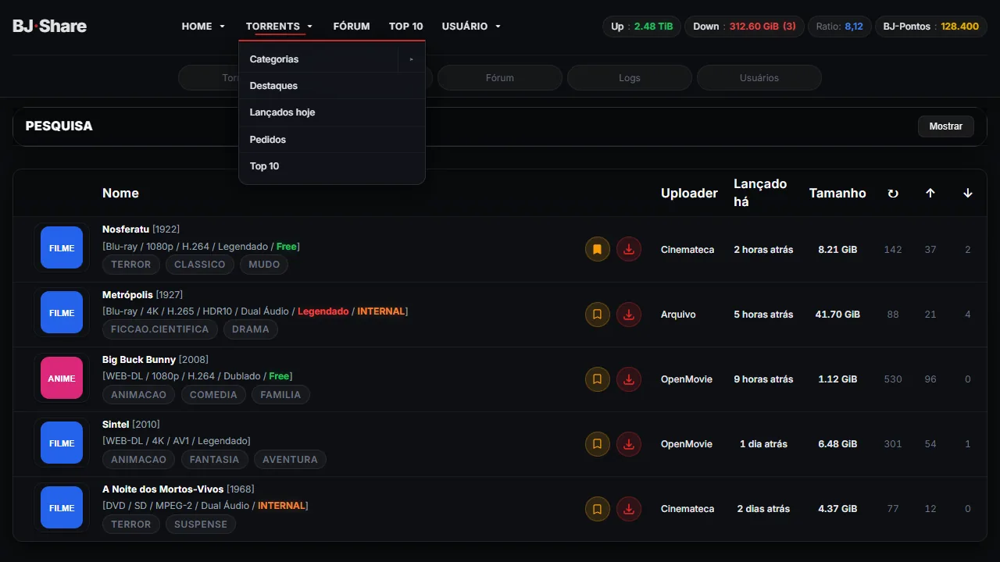 | **Light** `https://dsousamt.github.io/bjshare-darkglass-theme/bj-zerfeus-theme-light.css` 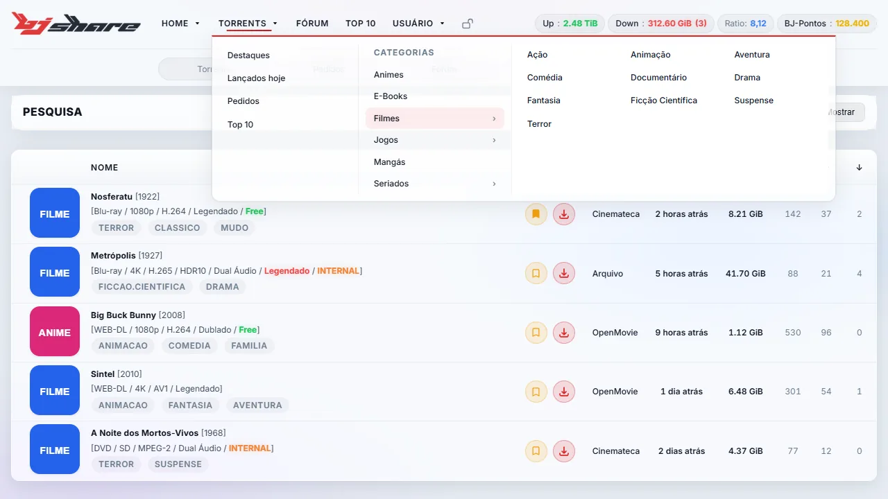 |
| **Dracula** `https://dsousamt.github.io/bjshare-darkglass-theme/bj-zerfeus-theme-dracula.css` 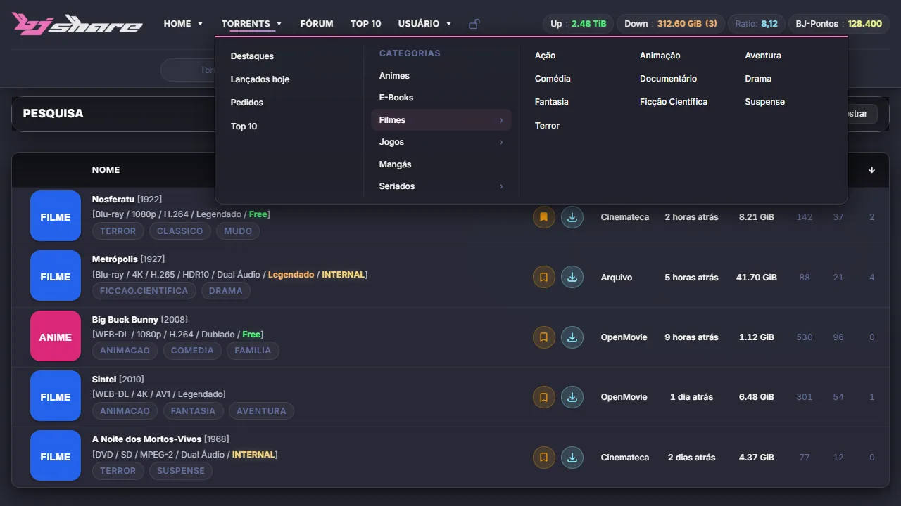 | **OLED** `https://dsousamt.github.io/bjshare-darkglass-theme/bj-zerfeus-theme-oled.css` 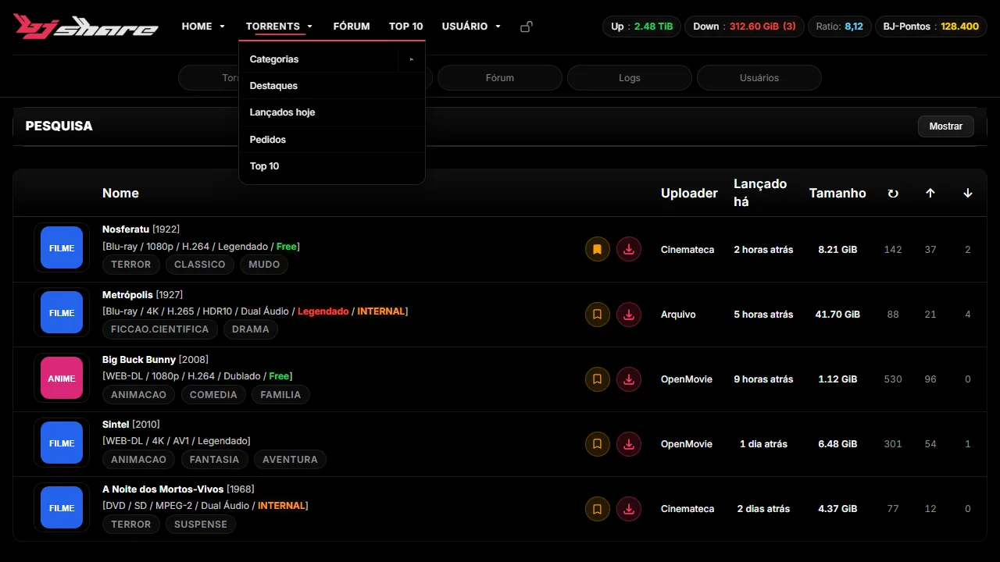 |
| **Monochrome** `https://dsousamt.github.io/bjshare-darkglass-theme/bj-zerfeus-theme-monochrome.css` 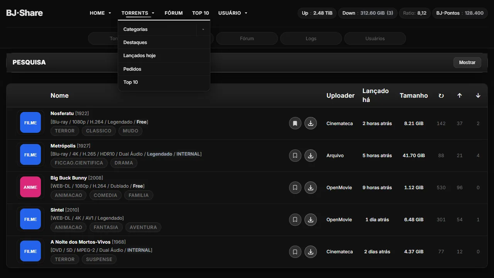 | **Solarized** `https://dsousamt.github.io/bjshare-darkglass-theme/bj-zerfeus-theme-solarized.css` 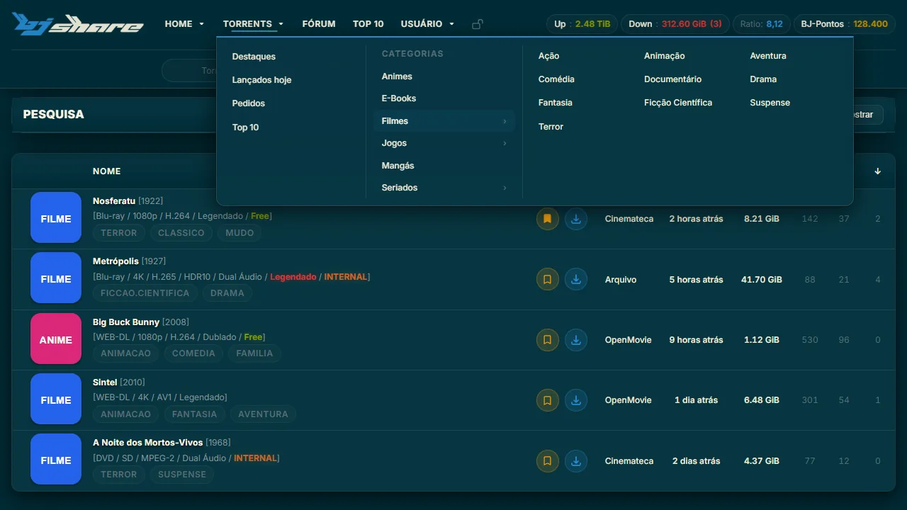 |
| **Sépia** `https://dsousamt.github.io/bjshare-darkglass-theme/bj-zerfeus-theme-sepia.css` 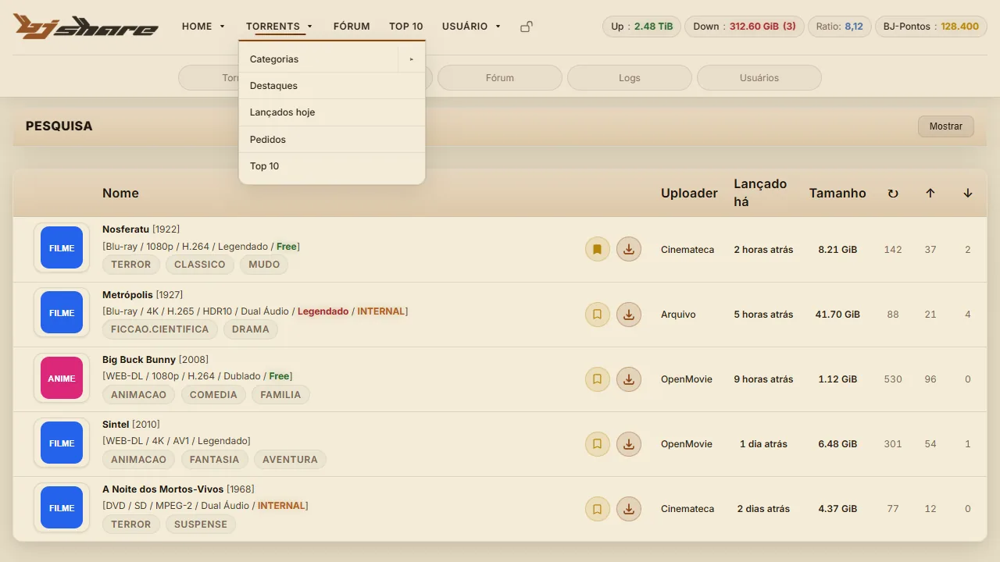 | **Alto Contraste** `https://dsousamt.github.io/bjshare-darkglass-theme/bj-zerfeus-theme-highcontrast.css` 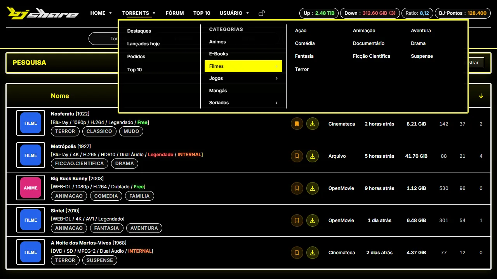 |
| **Matrix** `https://dsousamt.github.io/bjshare-darkglass-theme/bj-zerfeus-theme-matrix.css` 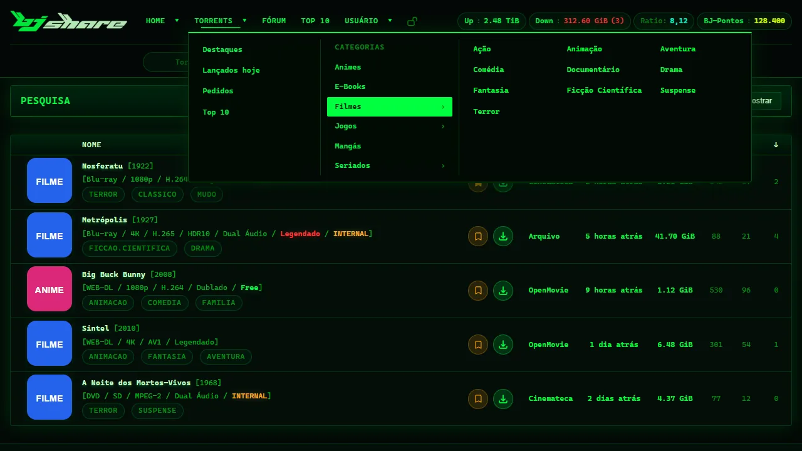 | **Cyberpunk** `https://dsousamt.github.io/bjshare-darkglass-theme/bj-zerfeus-theme-cyberpunk.css` 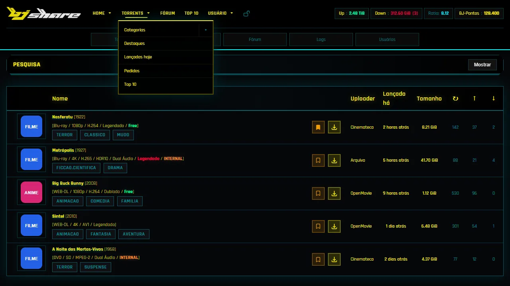 |
| **Windows 95** `https://dsousamt.github.io/bjshare-darkglass-theme/bj-zerfeus-theme-win95.css` 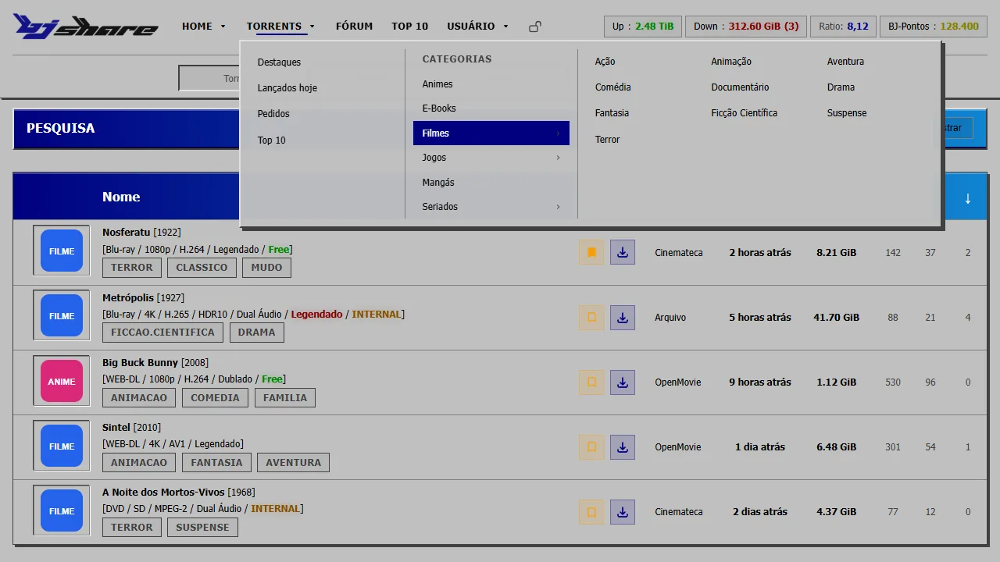 | **Orkut** `https://dsousamt.github.io/bjshare-darkglass-theme/bj-zerfeus-theme-orkut.css` 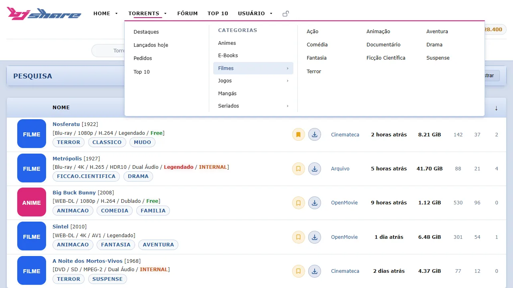 |
| **MSN** `https://dsousamt.github.io/bjshare-darkglass-theme/bj-zerfeus-theme-msn.css` 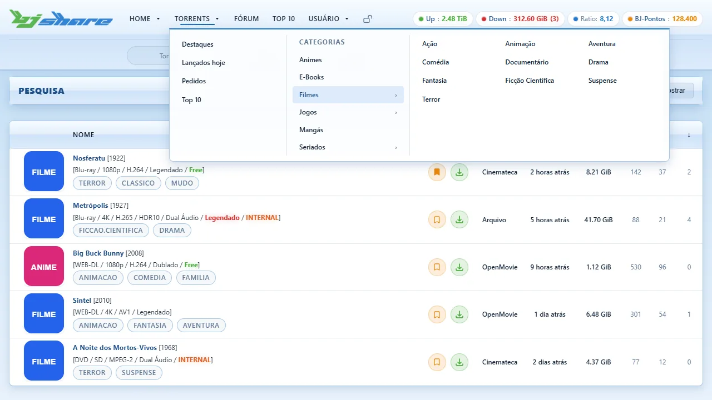 | |

Se a página ficar sem estilo, use a versão "arquivo único" do tema: troque `.css` por
`.full.css` no fim do link (ex.: `bj-zerfeus-theme-dracula.full.css`).

### Extra: BJ-Blue em negrito

O tema BJ-Blue original do site com todo o texto mais grosso, para quem precisa de mais legibilidade:

`https://dsousamt.github.io/bjshare-darkglass-theme/bj-blue-negrito.css`

O arquivo importa o BJ-Blue direto do BJ (`static/styles/bj-blue/style.css`), então acompanha as
atualizações do site. Ele só engrossa a letra: o texto comum vai para 600, o que já era negrito
fica mais forte, e os ícones do Font Awesome não são afetados.

## Para quem mexe no código

### Hospedagem

O GitHub Pages serve este repositório direto da `main`, e cada push chega ao site em cerca de
1 minuto. Cada variante importa o base por URL relativa (mesma pasta), então os arquivos
funcionam em qualquer host. Alternativa sem Pages:
`https://cdn.jsdelivr.net/gh/dsousamt/bjshare-darkglass-theme@main/<arquivo>.css`, que pode
manter cache por até 12 h. Não use `raw.githubusercontent.com`: ele serve os arquivos como
`text/plain`, e o navegador não aplica o CSS.

### Arquivos

| Arquivo | O que é |
| --- | --- |
| `bj-zerfeus-theme.css` | Tema base (DarkGlass): variáveis e todas as regras |
| `bj-zerfeus-theme-<nome>.css` | Variantes: só redefinem variáveis (e, no win95, cyberpunk, orkut e msn, algumas regras) |
| `bj-zerfeus-theme-<nome>.full.css` | Bundles gerados (base + variante); não edite à mão |
| `build-theme-bundles.ps1` | Gera os bundles |
| `index.html` | Guia publicado no GitHub Pages |
| `preview/demo.html` | Página de demonstração com a marcação do BJ e dados fictícios (`?tema=<nome>`) |
| `tools/gerar-previews.py` | Gera `assets/previews/*.webp` (e `.jpg`, para posts no fórum) a partir da demonstração e o mosaico `assets/todos-os-temas.jpg` (todas as prévias numa imagem, para posts no fórum) |
| `tools/gerar-fontes.py` | Gera as fontes embutidas no CSS (BJ Sep, BJ Tag e BJ Title, derivadas da Inter) e grava o base64 delas em `bj-zerfeus-theme.css`. Elas desenham o release em pílulas sem colchetes nem barras e deixam secundária a parte entre colchetes do título, coisas que o CSS sozinho não faz porque o site manda esse texto solto |
| `logos/` | Logos do BJ-Share (PNG, para fundo claro e escuro) e as máscaras `mask-*.png`, embutidas no CSS para pintar o logo com as cores de cada tema (`--logo-mark` e `--logo-text`) |

### Como o tema é organizado

`bj-zerfeus-theme.css` começa com dois blocos de variáveis:

- **1a. Sementes**: fundos, textos, acento, cores de estado, fontes e raios.
  É o que uma variante redefine.
- **1b. Derivados**: linhas, preenchimentos, rebaixos, sombras e tons do acento,
  calculados das sementes com `color-mix()`. Só redefina se o derivado não servir.

Três sementes controlam quase todos os tons sutis, e o alfa delas regula a intensidade:

- `--ink`: linhas finas e preenchimentos (branco em temas escuros, tinta escura em temas claros)
- `--recess`: áreas rebaixadas, como cabeçalhos e campos (preto; branco translúcido no OLED)
- `--shade`: sombras (preto; azul-marinho com alfa baixo no tema claro)

O BJ substitui o CSS do próprio site pela folha externa. Por isso, elementos nativos
(lightbox, `<dialog>` da gorjeta, etc.) precisam de estilo no tema, senão aparecem quebrados.

### Depois de editar

1. `.\build-theme-bundles.ps1` para regenerar os `.full.css`.
2. `python tools/gerar-previews.py` se mudou algo visual. Requer
   `pip install playwright pillow` e o Chrome instalado (ou `python -m playwright install chromium`).
3. Commit e push na `main`.

### Criar uma variante

1. Copie `bj-zerfeus-theme-dracula.css` para `bj-zerfeus-theme-<nome>.css` e troque as sementes no `:root`.
2. Rode os passos de "Depois de editar".
3. Adicione o tema à lista `TEMAS` no `index.html` e à tabela deste README.

As páginas salvas do BJ (Ctrl+S) contêm o token `auth=` da sua conta. O `.gitignore`
ignora todo `.html`, exceto `index.html` e `preview/demo.html`. Não salve páginas do BJ
com esses nomes.
